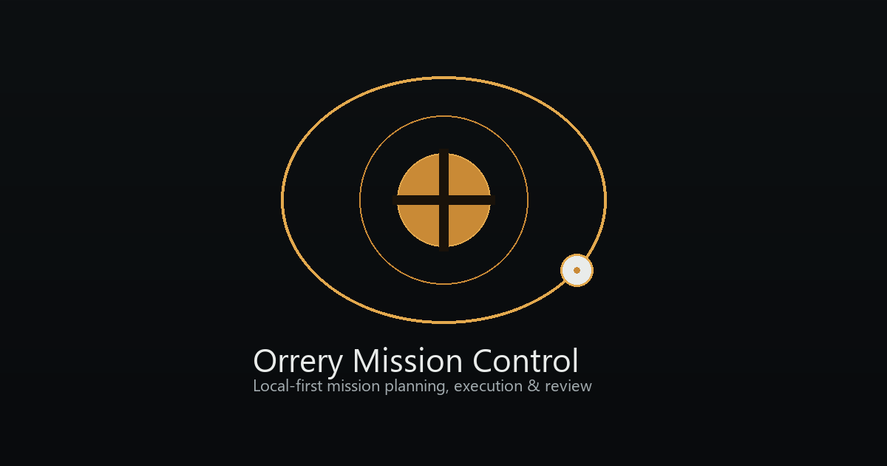
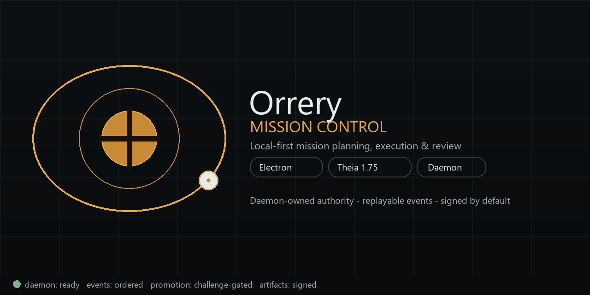

# Orrery Mission Control

<div align="center">



[](https://github.com/MoneyPack/Orrery/actions/workflows/ci.yml)
[](https://github.com/MoneyPack/Orrery/actions/workflows/theia-freshness.yml)
[](electron/)
[](theia-app/)
[](src/)
[](tsconfig.json)
[](LICENSE)

**Local-first mission planning, execution, and review — daemon-owned authority, replayable events, signed by default.**



| Pillar | What the operator keeps |
|---|---|
| Isolate | Every run executes in its own workspace, away from the working tree. |
| Approve | Plans and capability requests wait for an explicit decision. |
| Verify | Evidence and ordered events back every review before acceptance. |

[Getting started](#requirements) · [Architecture](#local-daemon-and-clients) · [Verification](#verification) · [Release policy](docs/upgrade-and-distribution.md) · [ADRs](docs/superpowers/adrs/README.md)

</div>

> Milestone 1 is a standalone local-first desktop app for Orrery's differentiated mission workflow — create, plan, approve, run isolated, guard permissions, gather evidence, review.

The repository now also contains a composable Theia 1.75.0 Mission Control extension and an isolated Theia Electron host under `theia-app/`. The extension contributes frontend, narrow Electron preload, and Electron-main modules; the host supplies the daemon-owning adapter without exposing the root desktop API to Theia.

The reference shell includes:

- A framework-independent mission domain with validated transitions and review-readiness invariants.
- A deterministic fixture runtime with ordered durable events and a scoped network capability request.
- Versioned local persistence under `orrery.missions.v1`.
- Compact Mission Control, editable Plan Canvas, Runtime Timeline, and Review Studio surfaces.
- Accept, reject, and request-revision decisions through domain transitions.
- A pre-boot welcome launcher: an inspirational entry with isolate / approve / verify pillars and a live mission count, shown once per session (skipped in packaged smoke mode) before the boot calibration hands off to Mission Control.
- Native motion choreography with no animation dependencies: `[data-reveal]` / `[data-stagger]` cascades, `.meter` run/scrub bars, `.beacon` live-status dots, and `[data-tick]` count-up bumps across the welcome state, runtime timeline, lifecycle rail, and replay debugger.
- Dark, light, and system themes; responsive layouts; keyboard focus; and reduced-motion support.

The browser regression flow remains fixture-backed, while the Node-side mission kernel now executes a deterministic local task in a real isolated Git worktree, records diff and command evidence, and promotes only an explicitly accepted reviewed change. Mission and temporary promotion worktrees live under an Orrery-owned private runtime root outside repository-controlled `.orrery` paths; callers can inject `workspaceRoot` into `GitWorkspaceService` and `MissionRunner`. Repository metadata such as promotion retry records may remain under `.orrery`. Trusted repository binding is deferred: the current kernel accepts a repository root from its trusted Node-side caller rather than exposing repository selection through the renderer.

## Source Documents

- [Product design](docs/superpowers/specs/2026-08-27-orrery-design.md)
- [Mission Control implementation plan](docs/superpowers/plans/2026-08-27-mission-control-slice.md)
- [Theia extension seam](theia-extensions/mission-control/README.md)
- [Isolated Theia Electron host](theia-app/README.md)
- [Real isolated mission kernel design](docs/superpowers/specs/2026-08-28-real-isolated-mission-kernel-design.md)
- [Daemon and OpenTUI control-plane design](docs/superpowers/specs/2026-08-28-daemon-opentui-control-plane-design.md)
- [Authoritative mission daemon design](docs/superpowers/specs/2026-08-28-authoritative-mission-daemon-design.md)
- [Upgrade and distribution policy](docs/upgrade-and-distribution.md)

## Requirements

| Prerequisite | Version | Notes |
|---|---|---|
| Node.js | 24 LTS | Browser + Electron toolchain |
| Node.js | 26.4.0+ with `--experimental-ffi` | Only for native OpenTUI commands |
| npm | 10+ | Workspaces + `--ignore-scripts` installs |

```bash
npm install
npm run dev
```

Vite prints the local URL. Mission and theme state persist in the browser's local storage. Use **Reset local demo** to clear mission records.

### One-minute tour

1. Open the welcome launcher and choose **Enter Mission Control**.
2. Create a mission, approve its plan, and start the fixture run.
3. Deny the scoped capability request, inspect the evidence, then accept.

### Screens

| Mission Control shell | Welcome launcher |
|---|---|
|  |  |

## Verification

| Gate | Command | What it proves |
|---|---|---|
| Types | `npm run typecheck` | Project references compile |
| Unit + component | `npm test -- --run` | 780+ tests green |
| Production bundle | `npm run build` | Renderer ships |
| Desktop bundles | `npm run desktop:build` | Main, preload, daemon |
| Packaged app | `npm run desktop:package` | Signed by default (or `ORRERY_UNSIGNED_LOCAL=1` for local-only) |
| Packaged smoke | `npm run desktop:smoke` | Executable boots + reports |
| Real kernel | `npm run mission:smoke` | Git worktree, evidence, promotion |
| Daemon authority | `npm run daemon:smoke` | Auth, replay, cancellation, restart |
| Browser flow | `npm run test:e2e` | Create → approve → run → review |
| Theia | `npm run theia-app:smoke` | Full host + every view renders |

Latest full matrix: [`docs/superpowers/2026-10-27-release-verification.md`](docs/superpowers/2026-10-27-release-verification.md). Theia extension checks: `theia:install`, `theia:typecheck`, `theia:test`, `theia:build`; host checks: `theia-app:install`, `theia-app:build`, `theia-app:typecheck`, `theia-app:test`.

## Desktop Development

The Electron shell uses the same Vite renderer. Its preload exposes only the versioned runtime-readiness API; the renderer retains browser behavior when that API is absent.

```bash
# Run Vite and the electron-builder-compatible Electron shell
npm run desktop:dev

# Create an unpacked Windows application under release/win-unpacked/
npm run desktop:package

# Launch and validate the packaged executable, then clean its repo-local profile
npm run desktop:smoke

# Create configured installers/archives under release/
npm run desktop:make
```

Desktop development accepts only an HTTP loopback Vite URL. Packaged applications load `dist/index.html` from the application bundle. Navigation and popups are blocked. Builds sign by default; unsigned local-only output requires `ORRERY_UNSIGNED_LOCAL=1`. Builder targets are Windows NSIS, portable, and zip; macOS dmg and zip; and Linux AppImage and deb.

The packaged smoke mode is enabled only by the `--orrery-smoke` and `--orrery-smoke-result=<path>` argv flags passed by the launcher; environment variables alone never activate it. The launcher supplies a fixed result path and `--user-data-dir` beneath `.tmp/desktop-smoke`; the main process accepts readiness only from the trusted renderer main frame and honors only the first valid report. The smoke-only preload method reports that the desktop runtime exists and that renderer `process` and `require` are both undefined. No generic IPC surface is exposed.

## Local Daemon And Clients

The authenticated loopback daemon is the sole authority for repository trust, mission execution and cancellation, durable snapshots and ordered events, inspection, and promotion. Electron and OpenTUI use the same `MissionControlClient` mutation and replay contracts; neither client receives Git, filesystem, process, command, or mission-kernel primitives. The companion TUI launcher reuses a ready daemon or starts one private child and stops only that child when the TUI exits. The standalone launcher requires an already-running daemon and never starts or stops one.

```bash
# Start the daemon explicitly.
npm run daemon

# Reuse or start a companion daemon for the terminal view.
npm run tui

# Connect only to an existing daemon.
npm run tui:standalone
```

Endpoint metadata, the capability token, the approved-repository registry, mission snapshots, append-only events, and the startup lock are stored under the OS-local Orrery runtime directory with restrictive permissions. The daemon binds only to numeric loopback and requires a fresh capability token for every daemon instance. A raw local path is accepted only by `propose_repository`; approval uses the returned canonical fingerprint and one-time nonce, and every ordinary mission request uses opaque repository and mission IDs plus exact revisions. Event subscriptions replay durable, per-mission sequence order after a cursor and reconnect. Active cancellation is daemon-owned: it aborts the real runner process and acknowledges only after cancellation is durable. OpenTUI is dynamically loaded only by the terminal package and requires Node.js 26.4+ with `--experimental-ffi`; browser and Electron bundles do not import it. SSH transport is deferred. Native OpenTUI is not required for protocol, lifecycle, or authority smoke tests.

Promotion is enabled only when Electron acquires the daemon startup lock and completes a single-use challenge/response over an inherited, non-reopenable child stdio pipe. Electron generates a fresh 32-byte random promotion approval key per managed daemon instance and hands it to the daemon only over that pipe; each approval is a short-lived HMAC capability (payload plus nonce, sealed with that key) rather than a signature. The daemon binds the pinned approval key to the lock nonce, parent and child process IDs, daemon instance challenge, readiness instance ID, and key fingerprint before publishing readiness. Environment variables, authenticated protocol clients, TUI processes, and web content cannot register or replace this key. This boundary prevents in-process and authenticated-client promotion forgery; arbitrary same-user native malware can already modify same-user files and repositories and remains outside this boundary unless OS-backed code identity is added later. See the [daemon and OpenTUI control-plane design](docs/superpowers/specs/2026-08-28-daemon-opentui-control-plane-design.md) for the trust model, endpoint/token lifecycle, event-gap behavior, and ownership boundaries.

The browser test creates and approves a mission, starts the fixture runtime, denies network access, inspects the resulting change and evidence, accepts the mission, reloads, and verifies persistence. The real mission smoke creates and removes its own disposable repository under repo-local `.tmp/real-mission-smoke` and a separate private worktree runtime under the operating-system temporary directory. The daemon authority smoke creates a disposable Git repository and private runtime under the operating-system temporary directory, exercises authenticated proposal through exact promotion plus active cancellation and restart replay, and removes both in `finally`; generated repository/worktree state is never used as the project checkout.

Production hosting must send `Content-Security-Policy: frame-ancestors 'none'` as an HTTP response header. Browsers ignore `frame-ancestors` in a meta-delivered policy, so the standalone shell deliberately omits that ineffective directive. Any future static hosting of `dist/` must serve the checked-in [`public/_headers`](public/_headers) config (Netlify/Cloudflare-Pages plain-headers form); `src/csp.test.ts` fails the deploy pipeline if that file is missing or drops the `frame-ancestors 'none'` directive. Verify the header on the deployed host before treating a release as done.

## Structure

- `src/domain`: mission contracts, reducer, invariants, and deterministic runtime.
- `src/state`: intent-level React provider and local persistence adapter.
- `src/components`: Mission Control, Plan Canvas, timeline, dialog, and Review Studio.
- `src/styles.css`: native tokenized dark/light and responsive design system.
- `electron`: secure main-process policy, fixed IPC contract, and sandboxed preload.
- `scripts/desktop-smoke.mjs`: deterministic packaged Windows smoke launcher.
- `scripts/real-mission-smoke.ts`: disposable real Git/worktree kernel smoke.
- `scripts/authoritative-daemon-smoke.ts`: disposable authenticated authority, replay, cancellation, restart, and promotion smoke.
- `theia-extensions/mission-control`: self-contained Theia 1.75.0 extension with frontend, preload, and host-injected Electron-main modules.
- `theia-app`: isolated Theia 1.75.0/Electron 42.8.1 application, packed-extension dependency, and host-only daemon composition.
- `packages/mission-control-domain`: framework-free domain extraction boundary.
- `e2e`: Chromium acceptance flow.
